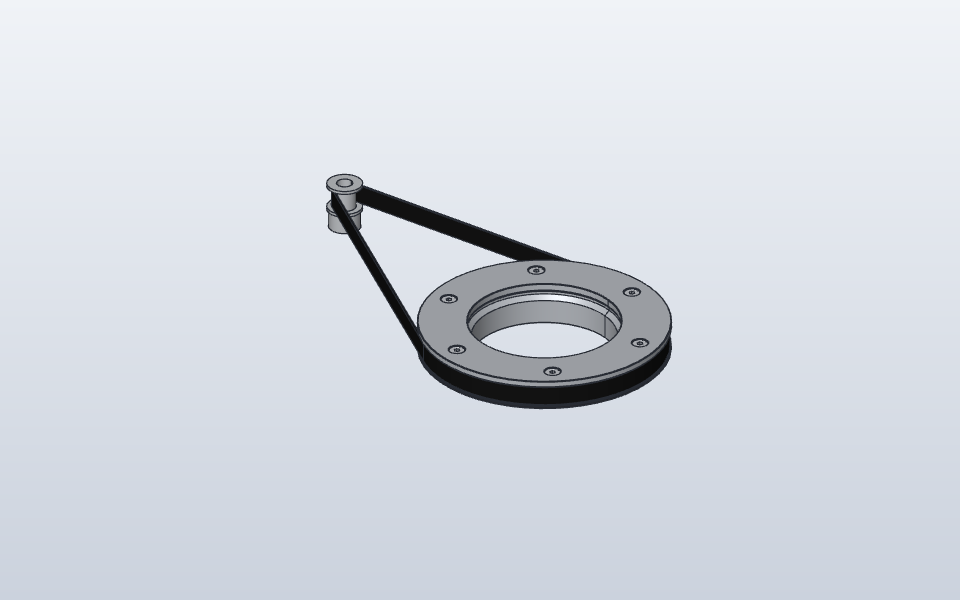

# OpenRoto

**A flat, belt-driven camera rotator for M48 imaging trains.** A THK RAU5005 crossed roller ring
carries the camera side; a printed 120-tooth GT2 sleeve on the telescope side is driven by a 12T
pulley and a closed 360 mm belt, so 10:1. About 10.4 mm of optical length, Ø45 clear aperture.

OpenRoto is the rotator of [Triton](../Triton/), the Esprit 100ED imaging train, and belongs to the
OpenWheel family. It has no electronics of its own: in Triton the motor runs on
[AstroUniBoard](../AstroUniBoard/) channel **R**.



## Specifications

| | |
|---|---|
| Interfaces | telescope side: female M48×0.75 (flattener); camera side: male M48×0.75 (OAG / next part) |
| Optical length | ~10.4 mm; overall height 13.05 mm |
| Clear aperture | Ø45 mm |
| Outside diameter | Ø78 mm (clamp ring); belt flange Ø77.9 mm |
| Bearing | THK RAU5005 crossed roller ring, 50 × 61 × 5 mm |
| Drive | 120T GT2 sleeve, 12T pulley, closed GT2 belt 360 mm × 6 mm, 10:1; centre distance 108.51 mm |
| Motor | 17HS08-1004S (NEMA 17 pancake), 16 µsteps → 88.889 steps/° |
| Homing | none on the rotator itself; Triton homes it with the AstroUniBoard IMU (gravity) |
| Materials | milled 6061-T6 rings, bead blasted and black matte anodised; printed PETG sleeve |

## How it works

```
 telescope / flattener  (M48 male)
        │
  ┌─────┴─────┐  clamp ring      ─┐
  │  bearing  │  outer ring       │ fixed: screwed to the flattener,
  │  RAU5005  │  GT2 sleeve 120T ─┘ the belt runs on the sleeve
  │           │  inner ring      ─┐
  └─────┬─────┘  spacer ring      │ rotating: carries the OAG, filter wheel and camera
        │                        ─┘
   OAG / camera  (M48 female)
```

- **Fixed side** (telescope): the clamp ring screws onto the flattener. Six M2.5 countersunk screws
  pull it into the printed GT2 sleeve and clamp the bearing's outer ring between them.
- **Rotating side** (camera): the bearing's inner ring sits on the inner ring's Ø50 seat under its
  Ø52 flange. The spacer ring below it is clamped by the next part of the train when that is screwed
  onto the inner ring's M48 thread.
- **Drive:** the motor rides on the rotating side (in Triton on the OpenWheel motor box) and walks its
  12T pulley around the fixed 120T sleeve with a closed belt. The motor mount is slotted for belt tension.

## Getting the parts

| What | Where | Documents |
|---|---|---|
| Inner, spacer and clamp ring | CNC, e.g. JLCCNC: 6061-T6, bead blast + black anodise | [`docs/cnc/`](docs/cnc/) — order guide, STEP + PDF drawing per part |
| GT2 sleeve | 3D print, PETG, flange down, no supports | [`cad/openroto_gt2_sleeve.3mf`](cad/openroto_gt2_sleeve.3mf), print notes in [`cad/README.md`](cad/README.md) |
| Bearing, screws, pulley, belt, motor | buy | [`docs/BOM.md`](docs/BOM.md) |

## Assembly

1. Slide the RAU5005 onto the inner ring's Ø50 seat from the thread side until it touches the Ø52 flange.
2. Slide the spacer ring onto the seat behind it (lip towards the bearing).
3. Put the inner ring with the bearing into the GT2 sleeve: the bearing's outer ring sits in the Ø61
   pocket on the sleeve's flange.
4. Put the clamp ring on top (spigot into the sleeve) and tighten the six DIN 7991 M2.5×8 screws
   evenly in a star pattern. They form their thread in the sleeve's Ø2.1 pilot holes: snug, not tight.
5. Screw the flattener into the clamp ring and the OAG (or the next part) onto the inner ring.
6. Lay the belt over the sleeve and the motor pulley and tension it with the motor's slots.

## Repository

| Folder | Content |
|---|---|
| [`cad/`](cad/) | SolidCraft designs (editable source), STEP and 3MF exports, the original STEP in `cad/original/` |
| [`docs/`](docs/) | BOM and the CNC order package ([`docs/cnc/`](docs/cnc/)) |
| `hw/`, `fw/`, `sw/` | empty: no electronics; the drive runs on AstroUniBoard |
| [`release/`](release/) | release packages (none yet) |

## Status

- 2026-11-08: release-1 rebuild of the original rotator in SolidCraft, all parts checked (no feature
  warnings, closed meshes, printable sleeve). CNC order package ready; one item to confirm before
  ordering: the Ø50 seat fit against THK catalog 382E (see [`docs/cnc/README.md`](docs/cnc/README.md)).
  Not built yet. The 12T pulley model is a typical envelope until the real part is measured.
