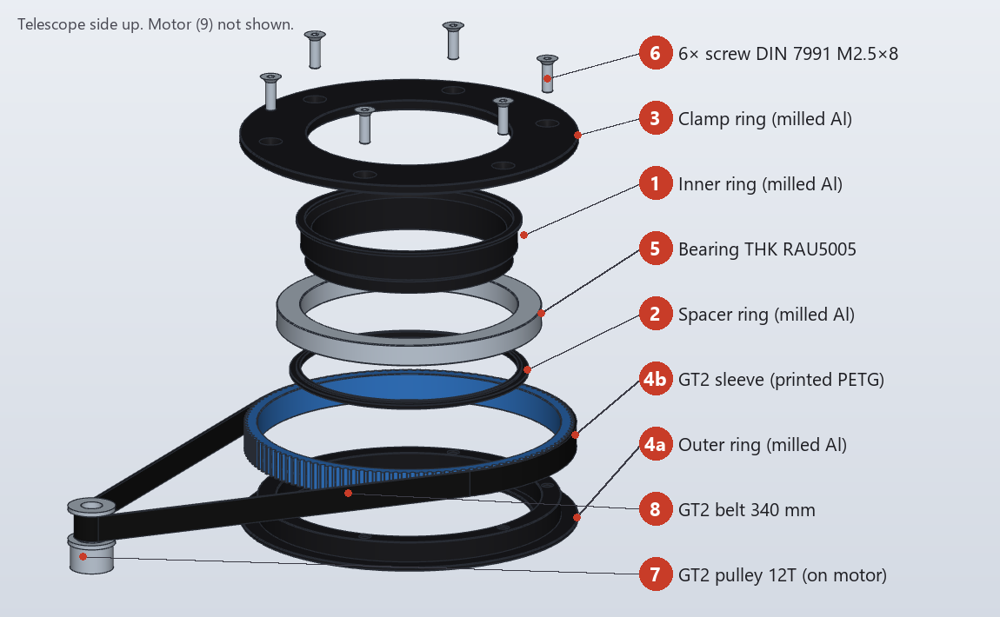
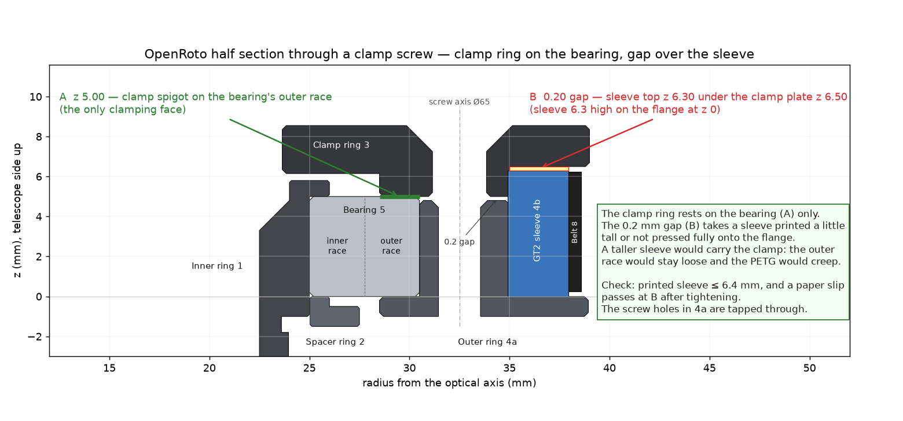

# Assembly

How to put one OpenRoto together and fit it into an imaging train. Item numbers match the [BOM](BOM.md)
and the exploded view (telescope side up). What each part does is in [`PARTS.md`](PARTS.md).

**How the loads run.** The whole camera train hangs on the inner ring 1 → bearing 5 → outer ring 4a →
**six M2.5 screws 6 (in tension)** → clamp ring 3 → the flattener's thread. The motor's reaction torque
runs the same way, plus through the belt 8 and the press-fitted GT2 sleeve 4b. Never let a hand twist on
the camera side react through the belt and the sleeve: that is the weak path.

## Tools and supplies

- Hex keys: 1.5 mm (screws 6, usually also the pulley's grub screws), plus 2 mm and 2.5 mm for the
  motor mount screws in Triton (M3 button head and M3 socket head)
- Calipers and a feeler gauge (0.05–0.5 mm), or a slip of printer paper (≈ 0.1 mm)
- Fine abrasive paper (240 → 400 grit) and a round former for fitting the bearing pocket;
  isopropyl alcohol to clean
- A rubber jar-opener pad (to hold the inner ring by its bore)
- Optional: torque screwdriver (0.3–0.5 N·m), low-strength (blue) threadlocker for the pulley grub screws

## Before you start: checks on the parts

1. **Clean** all parts and blow the chips and blasting media out of the tapped holes in the outer ring 4a.
2. **Tapped holes.** The six M2.5 holes in the outer ring 4a are tapped **through** (drawing rev B), so
   an M2.5×8 has full thread over its ~4.5 mm in the ring. On a ring made to the first
   drawing (rev A, holes drilled 4.8 blind), drill Ø2.1 through the remaining 1 mm floor and run the
   M2.5 tap through, or use **M2.5×6**.
   Check: turn one screw 6 through the clamp ring 3 into each hole, the clamp ring held on the bare outer
   ring with a 0.2 mm feeler under it (the gap the bearing fills later): every screw must run in by hand
   until its head sits in the countersink.
3. **Bearing fits** (JLCCNC does not hold a defined precision fit):
   - Bearing 5 on the inner ring 1: the RAU5005 should slide onto the Ø50 seat by hand, without play.
     On the first build this fit was fine as delivered.
   - Bearing 5 in the outer ring 4a: the outer race should go into the Ø61 pocket snugly, pushed in with
     even thumb pressure. On the first build the pocket was too tight: sand the pocket wall evenly (paper
     on a round former, turning the ring, re-trying often) until it fits. Stop as soon as it goes in —
     too loose lets the bearing shift. Clean off all dust.
4. **Sleeve height.** Measure the printed sleeve 4b: it is drawn **6.3 mm** high and must be **6.4 mm or
   less**. The clamp ring presses on the bearing's outer race; its plate stays 0.2 mm above the top of
   the sleeve. A sleeve that is too tall takes the clamping force and the bearing stays loose: sand the
   top face flat if it is over. (A sleeve printed from the first 6.5 mm file must be sanded to 6.3.)

   

   *Half section through a clamp screw ([`make_section.py`](make_section.py)): the clamp ring rests on
   the bearing's outer race (A, green); its plate stays 0.2 mm above the sleeve top (B).*
5. **Flattener (or other telescope-side part) thread length.** Its male M48 may go in **no more than
   2.7 mm** past the clamp ring's top face: below that runs the rotating inner ring's flange. Measure the
   male thread from its shoulder to its end; if it is longer, fit an M48 spacer ring (or a shorter
   adapter) between flattener and rotator. The clamp ring's female thread is only ~2.4 mm (about 3
   turns) long, so make sure the shoulder of the flattener sits flat on the clamp ring.
6. **Camera-side part.** Whatever screws onto the inner ring's male M48 (in Triton the OAG) must have
   at least **3.0 mm** of free female thread before any internal shoulder: its face has to reach the
   spacer ring 2, which is what clamps the bearing's inner race.

Never press on one race of the bearing to push the other: the force goes through the crossed rollers
and can dent the races. The steps below say which part to push with.

## Steps: the rotator on the bench

1. **GT2 sleeve onto the outer ring.** Press the sleeve 4b over the outer ring 4a's Ø70 rim (0.2 mm
   press fit) until it sits on the belt flange all round — press evenly with a flat board on a table.
   Check with the feeler gauge that there is no gap between sleeve and flange anywhere.
2. **Bearing into the outer ring.** Set the bearing 5 into the Ø61 pocket (outer ring flange down on
   the table). Push only on the bearing's **outer race**: lay the clamp ring 3 on top, spigot down, and
   press it — its spigot face covers the outer race only. The race must sit on the pocket floor.
3. **Inner ring into the bearing.** Put the inner ring 1 in from the top, thread first, and push it
   down by its flange until the flange sits on the bearing's inner race (the flange presses only on the
   inner race).
4. **Spacer.** Turn the stack over (hold the inner ring in, it is not retained yet). Slide the spacer
   ring 2 onto the inner ring's seat from the thread side, **the narrow raised step (Ø52 lip, 0.5 high)
   towards the bearing**. Upside down, its full Ø55 face would rub the bearing's outer race. Keep the
   stack thread-side up from now on, or the spacer falls out — it is only clamped in step 9.
5. **Clamp ring.** Turn the stack back, put the clamp ring 3 on, countersinks up, spigot into the top of
   the sleeve (a light press), holes over the tapped holes.
6. **Screws.** Turn all six screws 6 in by hand. Tighten in two rounds, going round in opposite pairs
   (a screw, then the one across from it, then the next pair): first just touching, then **snug, about
   0.3–0.5 N·m** — firm with the short arm of the 1.5 mm key. The screws carry the whole camera train, so
   all six must be in full thread (check 2), but M2.5 in aluminium strips easily: no more than that.
7. **Gap checks.** With a feeler or paper slip:
   - between the clamp ring's plate and the top of the sleeve there must be a gap (check 4) — if the
     paper is trapped, the clamp sits on the sleeve, not on the bearing: take it apart and sand the sleeve;
   - the clamp ring sits 0.2 mm above the outer ring's top face (it rests on the bearing, not on the ring).
8. **First turn.** Hold the clamp ring and turn the inner ring by its bore: smooth all round, no tight
   spots. A tight spot means uneven clamping (loosen all six, retighten in pairs) or a pocket still too
   tight.
9. **Camera-side part onto the inner ring — now, before the flattener.** Hold the inner ring by its Ø45
   bore from the telescope side (rubber pad) and screw the camera-side part (in Triton the OAG) onto the
   inner ring's male M48 until its face bears on the spacer ring 2, snug by hand. This clamps the
   bearing's inner race. Its angle on the inner ring does not matter: everything behind the bearing turns
   together. Once the flattener is in, the bore is covered and the inner ring can no longer be held —
   so do this first.
   Then check the **0.5 mm running gap**: the spacer stands 0.5 mm proud of the outer ring's bottom face,
   so a camera-side face wider than Ø57 runs 0.5 mm from the fixed ring. A paper slip must pass all round
   while you turn the camera side.

## Steps: in the imaging train (Triton)

10. **Onto the flattener.** Screw the rotator onto the flattener holding the **clamp ring or outer ring**
    (the fixed side), never the camera or filter wheel. The six screws are on a Ø65 circle and are
    probably covered by the flattener's body afterwards: any re-tightening of the clamp means taking the
    train off the telescope first.
11. **Pulley height (dry fit).** In Triton the motor 9 sits on the OpenWheel motor plate, and the pulley 7
    turns in the housing's pocket, where its grub screws cannot be reached. So: slide the pulley loosely on
    the shaft, mount the motor on the plate and the plate on the housing (OpenWheel
    [`cad/triton`](https://github.com/xlazam01/OpenWheel/tree/main/cad/triton)), lay the belt over sleeve
    and pulley, set the pulley so the belt runs straight and centred on it, and mark the shaft. Take the
    motor off again, tighten the grub screws on the shaft flat at the mark (a drop of blue threadlocker),
    and mount it for good.
12. **Belt.** Lay the belt 8 over the sleeve and the pulley with the plate's slot screws loose. Pull the
    plate away from the rotator until the belt is taut and tighten the four slot screws. The nominal
    position (centre distance 97.90 mm) is about **0.8 mm before the far end of the slots**: if the plate
    reaches the end and the belt is still slack, the belt is long or stretched — get another one.
    **Tension:** where the long span can be reached, a light finger press in its middle gives about
    2–3 mm. Too loose skips teeth with a heavy train; too tight loads the motor bearings and wears the
    printed teeth. Where the span runs inside the housing's channel, set it by the plate position.
13. **Cables.** Route the camera, filter wheel and motor cables so the camera side can turn ±180° from
    its working angle without pulling or snagging. Check this before any full-turn test.

## Final check

- **Turns freely:** before the belt goes on (step 8), the inner ring turns smoothly by hand over a full
  turn. With the belt on, do not spin the camera side by hand: through the 10:1 drive it spins the motor
  ten times faster and the motor feeds voltage back into the driver. If you must, turn slowly with the
  controller switched off.
- **No play:** hold the telescope side and rock the camera side axially and sideways — no knock or
  movement may be felt. If there is: the clamp sits on the sleeve, not on the bearing (step 7), the
  camera-side part is not down on the spacer (step 9), or the bearing pocket was sanded too far.
- **Belt tracks:** run a full turn with the motor (32 000 steps at 16 µsteps; 88.889 steps/°), with the
  cables free (step 13). The belt stays between the outer ring's belt flange and the clamp ring, does not
  climb the pulley flanges and does not skip.
- **Back to the start:** after +360° and −360° the rotator returns to its mark: no lost steps and no
  slip of the press-fitted sleeve on its rim.

## Taking it apart

Reverse order, and always hold the side whose thread you are turning:
- train off the telescope: hold the clamp ring / outer ring and unscrew from the flattener;
- camera-side part off the inner ring: only off the telescope, holding the inner ring by its bore — never
  on the telescope, where the inner ring could only react through the belt, the printed teeth and the
  press-fitted sleeve.
