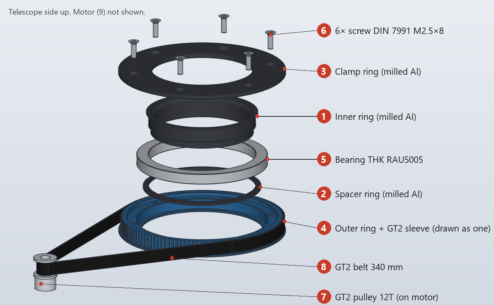

# Parts

What each part of OpenRoto does, what it is made of and how to get it. Numbers match the
[exploded view](openroto_exploded.png) and the [BOM](BOM.md). Dimensions and checks are in
[`../cad/README.md`](../cad/README.md); masses are computed from the CAD volumes.

The rotator has two halves. The **fixed side** (clamp ring, outer ring with the GT2 sleeve, the bearing's outer ring)
screws onto the telescope's flattener. The **rotating side** (inner ring, spacer ring, the bearing's
inner ring) carries everything behind it: OAG, filter wheel, camera, and the motor that drives it all.

## 1 — Inner ring (rotating side)

The bearing journal and the camera-side thread. A Ø45 bore (1.5 × 45° lead-in under a Ø48
counterbore), a Ø50 h6 seat for the bearing's inner ring under a Ø52 × 0.8 flange, and a male
M48×0.75 thread (2.7 mm long, Ø47.2 relief) for the OAG or the next part of the train.

- Material: aluminium 6061-T6, bead blasted and black matte anodised. ~8 g.
- Make: CNC turning; order with [`cnc/`](cnc/) (STEP + PDF drawing, the drawing carries the thread and
  the h6 fit). Check the seat with a micrometer on delivery.

## 2 — Spacer ring (rotating side)

A thin washer (Ø50.05 / Ø55 × 1.5 with a Ø52 × 0.5 lip) under the bearing's inner ring. When the next
part is screwed onto the inner ring's M48 thread, it presses on the spacer, and the spacer clamps the
bearing's inner ring against the inner ring's flange.

- Material: aluminium 6061-T6, bead blasted and black matte anodised. ~1.3 g.
- Make: CNC turning (same order as the other rings). Faces flat 0.01, parallel 0.02.

## 3 — Clamp ring (fixed side)

The telescope-side interface and the bearing's outer clamp. Ø78 × 3.55 with a female M48×0.75 thread
for the flattener, a Ø57 recess over the inner ring's flange, a Ø70 × 1.5 spigot that centres it in the
outer ring, and six Ø2.7 holes countersunk 90° on a Ø65 circle.

- Material: aluminium 6061-T6, bead blasted and black matte anodised. ~22 g.
- Make: CNC turning + drilling; order with [`cnc/`](cnc/). Bottom face flat 0.02.

## 4 — Outer ring + GT2 sleeve (fixed side)

> **The CAD draws these as one printed body (`openroto_gt2_sleeve`); the real rotator has two parts.**
> The release-1 rebuild merged the original's two bodies by mistake. Splitting the model is open work;
> until then the STEP/3MF of `openroto_gt2_sleeve` is **not** a print or order file.

**4a — Outer ring (milled).** The bearing housing: a Ø61 pocket for the bearing's outer ring, six
tapped M2.5 holes on a Ø65 circle for the clamp-ring screws, and the rim the GT2 sleeve sits on.

- Material: aluminium 6061-T6, bead blasted and black matte anodised.
- Make: CNC (JLCCNC, like the other rings).
- **Bearing fit:** JLCCNC cannot guarantee a defined precision fit. On the first build the Ø61 pocket
  came out too tight and was sanded until the RAU5005 sat in it snugly; the inner ring's Ø50 seat was
  fine as delivered. Expect to fit the pocket by hand, or order it from a shop that holds the tolerance.

**4b — GT2 sleeve (printed).** A thin printed ring carrying the 120 GT2 teeth and the Ø77.9 belt
flange. It is pressed over the outer ring's rim and held by friction.

- Material: PETG (stiff, little creep).
- Make: print flange down, no supports, 0.2 mm layers, at least 3 perimeters so the teeth are solid.

## 5 — Crossed roller ring THK RAU5005 (bought)

50 × 61 × 5 mm crossed roller bearing: carries axial, radial and tilting loads in one thin ring, so
the camera cannot sag or wobble. Its outer ring is clamped between the outer ring and the clamp ring (fixed), its
inner ring between the inner ring's flange and the spacer (rotating). ~38 g.

## 6 — Screws DIN 7991 M2.5×8, ×6 (bought)

Hex socket countersunk screws, A2 stainless, 1.5 mm key. They screw into the tapped holes of the outer ring and
clamp the bearing's outer ring; the heads sit 0.25 mm below the clamp face.

## 7 — GT2 pulley 12T (bought)

12-tooth GT2 pulley for a 6 mm belt, 5 mm bore, fixed to the motor shaft with its grub screws. The
CAD model is a typical envelope, not a datasheet part.

## 8 — GT2 belt 340 mm (bought)

Closed GT2 belt, 340 mm (170 teeth), 6 mm wide. 120T : 12T gives 10:1. Centre distance 97.900 mm
(pitch radii 38.197 / 3.820 mm, wrap 221.1° on the sleeve).

## 9 — Stepper motor 17HS08-1004S (bought, not drawn)

NEMA 17 pancake stepper, 1.0 A, 5 mm shaft. It rides on the rotating side and walks its pulley around
the fixed sleeve. At 16 microsteps: 200 · 16 · 10 = 32 000 steps per turn of the camera, 88.889 steps/°.
The motor mount is not part of this repo (see [BOM](BOM.md#not-in-this-bom)).
